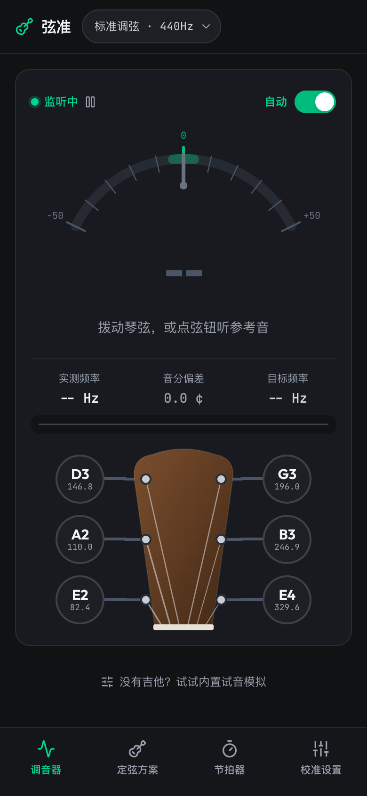
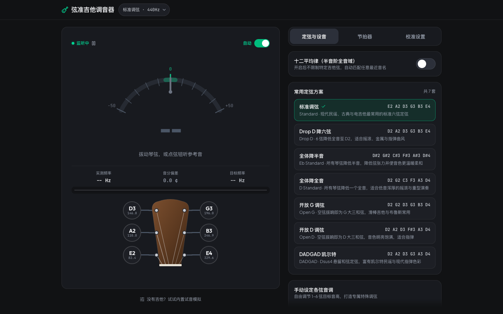

# Xianzhun Guitar Tuner

English | [简体中文](README.zh-CN.md)

A guitar tuner and metronome that runs in the browser, on Android, macOS and Windows. It listens through the microphone and shows how far each string is from its target note.

- **Use online**: <https://xianzhun.pages.dev> (add to home screen to use it offline)
- **Download**: Android, macOS and Windows builds on the [Releases](https://github.com/sundy-li/xianzhun/releases) page

<p align="center">
  
  &nbsp;
  
</p>

## Features

- **Auto mode** recognises which string you plucked. **Manual mode** locks one string: tap its peg on the headstock.
- Pitch detection is accurate to about 1 cent in a quiet room. Steady hum (fridge, transformer) is ignored, and the app warns when the input is too loud.
- Reference tones for every string, played once or on a loop.
- 7 built-in tunings (Standard, Drop D, Eb, D, Open G, Open D, DADGAD), custom tunings and a chromatic mode.
- A4 calibration (430–450 Hz), capo (0–7), and a choice of in-tune tolerance (±2 / ±4 / ±8 cents).
- Metronome: 30–240 BPM, tap tempo, 6 time signatures.
- Installable PWA that works offline.

See [Features](docs/en/features.md) for details.

## Quick start

```bash
bun install
bun run dev      # http://localhost:3000
```

## Documentation

| Doc | Contents |
|---|---|
| [Features](docs/en/features.md) | Tuner, tunings, calibration, metronome, how detection works |
| [Installation](docs/en/install.md) | Web / PWA, Android, macOS, Windows, microphone troubleshooting |
| [Development](docs/en/development.md) | Requirements, commands, project layout, native builds |
| [Release & deploy](docs/en/release.md) | Publishing a GitHub release, Cloudflare Pages, CI secrets |

## Tech stack

React 19, TypeScript, Vite, Tailwind CSS v4, Web Audio API, `vite-plugin-pwa`. Native apps are packaged with [Tauri 2](https://tauri.app).
