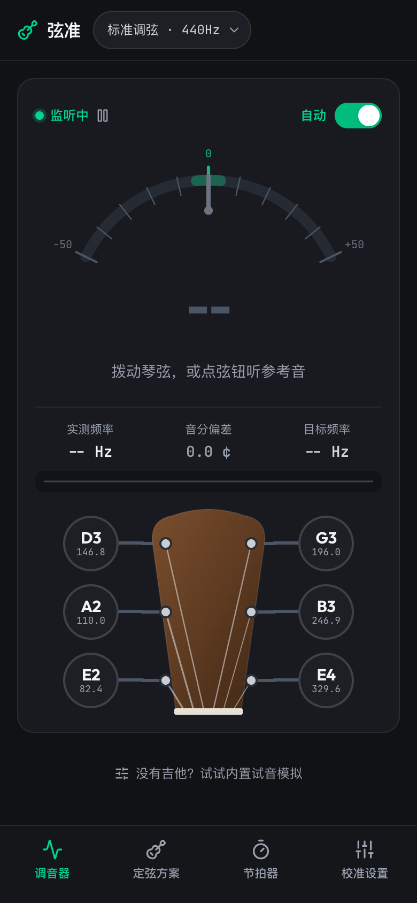
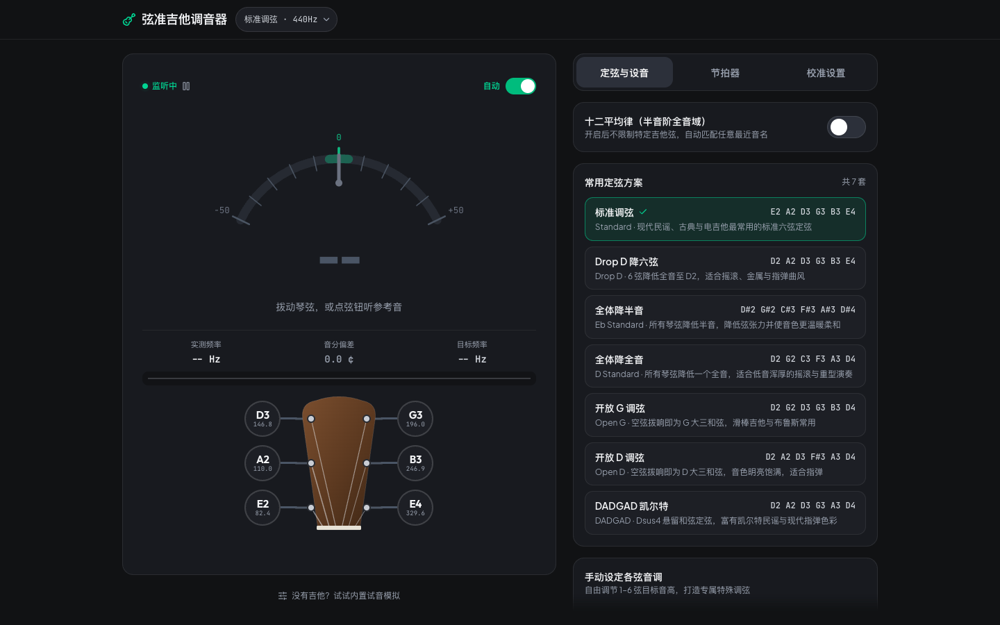

# 弦准吉他调音器

[English](README.md) | 简体中文

吉他调音器和节拍器，可以在浏览器、Android、macOS 和 Windows 上使用。它通过麦克风收音，显示每根弦和目标音差多少。

- **在线使用**：<https://xianzhun.pages.dev>（添加到主屏幕后可离线使用）
- **下载安装包**：Android、macOS、Windows 版本见 [Releases](https://github.com/sundy-li/xianzhun/releases)

<p align="center">
  
  &nbsp;
  
</p>

## 功能

- **自动模式**识别你弹的是哪根弦；**手动模式**锁定一根弦，点琴头上的弦钮即可切换。
- 安静环境下音高误差约 1 音分。冰箱、变压器这类持续嗡声会被忽略，输入过大时有提示。
- 每根弦都有参考音，可以单次播放或持续播放。
- 内置 7 种定弦（标准、Drop D、降半音、降全音、开放 G、开放 D、DADGAD），支持自定义定弦和十二平均律模式。
- A4 校准（430–450 Hz）、变调夹（0–7 品）、音准容差（±2 / ±4 / ±8 音分）。
- 节拍器：30–240 BPM，点击测速，6 种拍号。
- 可安装的 PWA，离线可用。

详见[功能说明](docs/zh-CN/features.md)。

## 快速开始

```bash
bun install
bun run dev      # http://localhost:3000
```

## 文档

| 文档 | 内容 |
|---|---|
| [功能说明](docs/zh-CN/features.md) | 调音、定弦、校准、节拍器、检测原理 |
| [安装](docs/zh-CN/install.md) | 网页 / PWA、Android、macOS、Windows，麦克风问题排查 |
| [开发](docs/zh-CN/development.md) | 环境要求、常用命令、目录结构、原生应用构建 |
| [发布与部署](docs/zh-CN/release.md) | 发布 GitHub Release、Cloudflare Pages、CI 密钥 |

## 技术栈

React 19、TypeScript、Vite、Tailwind CSS v4、Web Audio API、`vite-plugin-pwa`。原生应用用 [Tauri 2](https://tauri.app) 打包。
